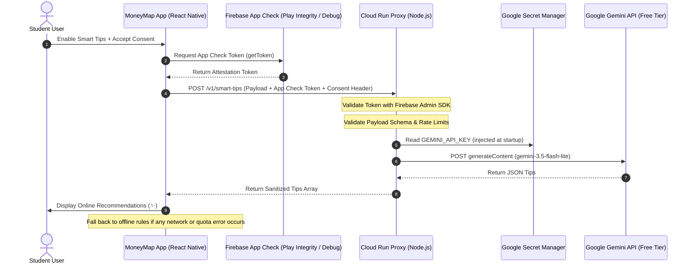

# Firebase App Check & Google Cloud Run AI Integration Guide

## 1. Overview & Architecture

MoneyMap is an **offline-first personal finance tracker**. Transactions, budgets, accounts, recurring rules, reports, and campus food catalogs remain 100% operational on-device without internet connectivity.

Optional Gemini AI personalization is available for **Smart Tips** and **Student Eats Near Me**. To protect user privacy and project quotas:
- **No Gemini credentials** are ever bundled with the mobile client.
- Outbound requests pass through a stateless **Google Cloud Run proxy**.
- **Firebase App Check** attests that requests originate from a legitimate, untampered build of MoneyMap before the proxy queries Gemini.
- Only **anonymized summaries** (never raw transactions, notes, or coordinates) are transmitted.



---

## 2. Cloud Configuration & Project References

| Resource | Value | Notes |
|---|---|---|
| **Google Cloud Project** | `Google-Developer-Program-Trial` | Project ID: `project-50d13184-689a-4396-ab2` |
| **Android Package Name** | `com.moneymap.financetracker` | Must match `app.json` / `app.config.js` |
| **App Check Provider** | Play Integrity (Release) / Debug (Development) | Registered in Firebase Console |
| **Cloud Run Service Account** | `moneymap-ai-run@project-50d13184-689a-4396-ab2.iam.gserviceaccount.com` | Granted `Secret Manager Secret Accessor` on `moneymap-gemini-key` |
| **Secret Manager Secret** | `moneymap-gemini-key:1` | Holds Gemini API key from Archim-Gemini-Default-Project |
| **Allowed Models** | `gemini-3.5-flash-lite`, `gemini-1.5-flash` | Free Tier only; paid models strictly blocked |
| **Budget & Spend Control** | $1 monthly budget alert + max 1 Cloud Run instance | Enforced to prevent trial credit consumption |

---

## 3. Firebase & Expo Native Configuration

### A. Gitignore & Credentials Safety
Per `AGENTS.md` and Google Cloud security standards, `/google-services.json` is gitignored:
```gitignore
/google-services.json
```
Never commit API keys, service account JSON files, keystores, or debug tokens to version control.

### B. Dynamic Expo Config ([app.config.js](file:///home/kakashi70-0/Documents/GitHub/TIP_MoneyMap-Finance-Tracker-App/app.config.js))
Expo dynamically incorporates `@react-native-firebase/app` and `@react-native-firebase/app-check` plugins and links the native Google Services configuration:
```javascript
module.exports = ({ config }) => {
  return {
    ...config,
    android: {
      ...(config.android ?? {}),
      googleServicesFile: "./google-services.json",
    },
    plugins: [
      ...(config.plugins ?? []),
      "@react-native-firebase/app",
      "@react-native-firebase/app-check",
    ],
    extra: {
      ...(config.extra ?? {}),
    },
  };
};
```

---

## 4. Mobile Implementation

### A. App Check Token Provider ([src/remote/firebaseAppCheck.js](file:///home/kakashi70-0/Documents/GitHub/TIP_MoneyMap-Finance-Tracker-App/src/remote/firebaseAppCheck.js))
- Uses `@react-native-firebase/app-check` modular v27 API.
- Configures `debug` provider in `__DEV__` and `playIntegrity` in production builds.
- Enables `isTokenAutoRefreshEnabled: true` for automatic background renewal.
- Supports `getMoneyMapAppCheckToken(forceRefresh = false)` with single-lifecycle promise memoization and controlled retry.

### B. AI Proxy Client ([src/remote/aiProxyClient.js](file:///home/kakashi70-0/Documents/GitHub/TIP_MoneyMap-Finance-Tracker-App/src/remote/aiProxyClient.js))
- Enforces strict fail-closed security: requires `enabled === true`, `consentAccepted === true`, and a valid token.
- Includes automatic retry with `forceRefresh = true` on HTTP 401 responses to recover from expired tokens.
- Enforces a 12-second abort timeout.
- Helper `isAiProxyConfigured()` verifies both the HTTPS backend URL and provider registration.

### C. Application Entry Hook ([App.js](file:///home/kakashi70-0/Documents/GitHub/TIP_MoneyMap-Finance-Tracker-App/App.js))
- Registers the App Check provider before mounting the application root.
- Uses dynamic `await import("./src/remote/firebaseAppCheck")` so native Firebase SDK loading is lazy and decoupled until a token is requested.

### D. UI State Indicators ([src/screens/SmartTipsScreen.jsx](file:///home/kakashi70-0/Documents/GitHub/TIP_MoneyMap-Finance-Tracker-App/src/screens/SmartTipsScreen.jsx))
Accurately differentiates all 6 online and offline states:
1. **Online recommendations available (✨):** AI suggestions loaded successfully.
2. **Connecting to online personalization (⏳):** Request in flight.
3. **Online personalization disabled (📱):** Toggle off or consent unconfirmed.
4. **Online personalization not configured (⚙️):** Enabled but backend URL or provider missing.
5. **Online service unavailable (⚠️):** Server/quota error; offline rules displayed.
6. **Offline recommendations available (📱):** Standard offline rule-based recommendations.

---

## 5. Google Cloud Run Backend

Located in [backend/moneymap-ai/](file:///home/kakashi70-0/Documents/GitHub/TIP_MoneyMap-Finance-Tracker-App/backend/moneymap-ai/).

### Deployment Command
```bash
gcloud run deploy moneymap-ai-proxy \
  --source backend/moneymap-ai \
  --region asia-southeast1 \
  --platform managed \
  --allow-unauthenticated \
  --service-account moneymap-ai-run@project-50d13184-689a-4396-ab2.iam.gserviceaccount.com \
  --set-secrets="GEMINI_API_KEY=moneymap-gemini-key:1" \
  --set-env-vars="FIREBASE_PROJECT_ID=project-50d13184-689a-4396-ab2,GEMINI_MODEL=gemini-3.5-flash-lite,EXPECTED_FIREBASE_APP_ID=1:644502021888:android:b55d182b7c556e414f35e5" \
  --max-instances 1 \
  --memory 256Mi \
  --cpu 1 \
  --timeout 15s
```

### Server Safeguards
- **App Check Verification & App ID Check:** Token validated via `firebase-admin/app-check`. When `EXPECTED_FIREBASE_APP_ID` is set, requests from any other app in the same Firebase project are rejected with HTTP 403 (`unauthorized_app`).
- **Free Tier Whitelist:** `ALLOWED_FREE_TIER_MODELS` strictly whitelists `gemini-3.5-flash-lite` and `gemini-1.5-flash`. Paid or unlisted models are rejected with 503.
- **Per-Client Rate Limiter:** 8 requests per minute per verified application ID and client IP (`${appId}:${clientIp}`). Prevents a single client from exhausting rate limits for other users.
- **Payload Validation:** Enforces strict limits on arrays, string lengths, and minor currency amounts. Rejecting transactions, notes, or coordinates with 422.
- **Cost & Quota Safeguards:** Bounded to 1 instance (`--max-instances 1`) with $1 monthly budget alert. Note: Budget alerts notify administrators of spend, but do not automatically terminate active instances.

---

## 6. Testing & Quality Assurance Runbook

### Running Automated Tests
```bash
# Mobile test suite (65 suites, 470 tests)
npm test

# Android launcher environment check
npm run test:android-launcher
npm run android:check

# Backend proxy test suite (8 tests)
cd backend/moneymap-ai && npm test
```

### Android Emulator Testing with App Check Debug Provider
1. Start the Android emulator:
   ```bash
   node scripts/emulator.mjs start
   ```
2. Build and run the development app:
   ```bash
   npm run android:preserve
   ```
3. Inspect Android Logcat for the Firebase App Check debug token:
   ```bash
   adb logcat -s "FirebaseAppCheck" | grep "Debug token"
   ```
4. Copy the generated UUID debug token and register it in the **Firebase Console → App Check → Apps → com.moneymap.financetracker → Manage debug tokens**.
5. Optionally set `EXPO_PUBLIC_FIREBASE_APPCHECK_DEBUG_TOKEN=<UUID>` in your local `.env`.
6. Set `EXPO_PUBLIC_MONEYMAP_AI_URL=<Cloud Run Service URL>` in `.env`.
7. Navigate to **Smart Tips** or **Student Eats** in MoneyMap, enable the toggle, accept consent, and verify that the status badge updates to `Online recommendations available`.

---

## 7. Remaining Manual Actions in Google Cloud & Firebase Console

Before live testing with Cloud Run:
1. **Firebase Console:**
   - Under **App Check → Apps**, verify that `com.moneymap.financetracker` is registered under Android.
   - For Play Store release builds: link **Play Integrity** with the Google Play Console signing SHA-256 fingerprint.
   - For emulator testing: register the debug token output from Logcat.
2. **Google Cloud Run:**
   - Run the `gcloud run deploy` command shown in Section 5.
   - Ensure the Cloud Run service URL is placed into `.env` as `EXPO_PUBLIC_MONEYMAP_AI_URL=https://...`.
3. **Secret Manager:**
   - Verify version 1 of `moneymap-gemini-key` contains the valid Gemini API key from `Archim-Gemini-Default-Project`.
